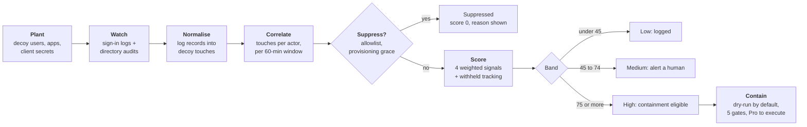

# entra-tripwire

> **Maintained.** One of the four tools here I keep current: bug fixes, dependency and
> rule-catalogue updates, and issues answered. The rest of my tools are published as
> snapshots and say so at the top of their README.

> 🔎 **Try this and the whole suite online — no install:** [consulting.arrankago.com](https://consulting.arrankago.com) · plus managed security and M365/Entra identity assessments for teams.

[](https://github.com/earbona23/entra-tripwire/actions/workflows/ci.yml)
[](https://www.powershellgallery.com/packages/EntraTripwire)
[](https://www.powershellgallery.com/packages/EntraTripwire)
[](https://learn.microsoft.com/powershell/scripting/install/installing-powershell)
[](LICENSE)
[](docs/scoring.md#mutation-testing)
[](#development-tests-and-mutation-testing)
[](#five-minutes-no-tenant)

**Deception-based intrusion detection for Microsoft Entra ID.**

**In one sentence, if you have never heard of this:** it plants fake user accounts and fake
app credentials in your tenant — objects no real person and no real process has any reason
to touch — and tells you when something touches one. Because the only thing that touches
them is somebody looking around who should not be there.

Plant identities, application registrations and credentials that no legitimate process
should ever touch. Watch Microsoft Graph for contact with them. When something touches one,
score it — hard — before it reaches a human, and optionally contain the actor.

Every other Entra security tool answers *how could someone get in*. This one answers a
different question, and it is the question you have after the first one stops being
hypothetical:

> **Is someone in here right now?**

```powershell
Install-Module EntraTripwire -Scope CurrentUser
Watch-TripwireActivity -Demo | Format-Table Confidence, Band, DecoyName, ActorLabel
```

No elevation, and nothing else to install. The PowerShell Gallery is not a trusted
repository by default, so the first install asks you to confirm it and **the default answer
is `N`** — answer `Y`. Later, `Update-Module EntraTripwire` takes you to the newest version;
the Gallery has no mechanism to notify you that one exists, so that is a command you run
rather than a prompt you receive.

Why a Gallery module and not a downloadable `.exe`, with the measurements behind that
choice: **[docs/distribution.md](docs/distribution.md)**.

```
Confidence Band       DecoyName            ActorLabel
---------- ----       ---------            ----------
    99.600 High       svc-backup-archive   svc-backup-archive
    74.600 Medium     p.morales            p.morales
    74.600 Medium     admin.legacy         svc-backup-archive@contoso.com
    74.600 Medium     sql-reporting-svc    svc-backup-archive@contoso.com
    74.600 Medium     Legacy VPN Connector svc-backup-archive@contoso.com
    40.300 Low        svc-backup-archive   helpdesk1@contoso.com
    34.600 Low        hr-export            svc-backup-archive@contoso.com
     0.000 Suppressed svc-backup-archive   admin@contoso.com
     0.000 Suppressed admin.legacy         Contoso Vulnerability Scanner
```

That output came from the fixtures inside the module. No tenant, no credentials, no network.

---

## Contents

- [The Active Defense Trilogy](#the-active-defense-trilogy)
- [When you would actually reach for this](#when-you-would-actually-reach-for-this)
- [Five minutes, no tenant](#five-minutes-no-tenant)
- [How it works](#how-it-works)
- [The interesting part: the false-positive engine](#the-interesting-part-the-false-positive-engine)
- [Reading that demo output](#reading-that-demo-output)
- [What you actually end up with](#what-you-actually-end-up-with)
- [Against a real tenant](#against-a-real-tenant)
- [Containment](#containment)
- [Safety properties](#safety-properties)
- [Free vs Pro](#free-vs-pro)
- [Development, tests and mutation testing](#development-tests-and-mutation-testing)
- [Limitations](#limitations)
- [Support the project](#support-the-project)
- [Contributing](#contributing)
- [Licence, attribution and the name](#licence-attribution-and-the-name)

---

## The Active Defense Trilogy

Three tools, one idea: **an intruder who is already inside leaves traces that a
vulnerability scan will never find.**

| | Tool | Question it answers |
|---|---|---|
| **1. Detect** | **entra-tripwire** *(this repo)* | Is someone in here right now? |
| **2. Analyse** | [revtriage](https://github.com/earbona23/revtriage) | What did they actually do, and in what order? |
| **3. Contain** | [containment-cut](https://github.com/earbona23/containment-cut) | What is the smallest cut that stops them without stopping the business? |

Each stands alone, and each is a separate repository with its own tests — there is no
shared runtime, no common library and nothing to install from one to use another. What
they share is a posture: read-only by default, dependency-light, and structurally unable
to do the destructive thing they are near.

## When you would actually reach for this

Deception is the cheapest high-signal detection a small team can run, and it is the only
one that gets *better* the quieter your tenant is. Concrete moments where it earns its
place:

**The week after an incident.** You evicted them. Did they come back? Plant decoys shaped
like whatever they touched last time — the service account naming convention they went
for, an app registration with a secret, the dormant admin they found. If the same tradecraft
runs again, it lands on a decoy first, and you find out on day one instead of day ninety.

**A tenant with no SOC.** Two hundred users, one IT person, no budget for a detection
engineer. You cannot write behavioural analytics. You *can* plant nine objects nothing
legitimate touches and page a human when something does. The false-positive engine exists
precisely so the one IT person does not switch it off in week two.

**Before a red team engagement, not after.** Plant the decoys, tell nobody, and use the
report as the scoreboard. If the red team walks the directory and never trips one, your
decoys are badly placed — which is a finding you got for free, before the real thing.

**A privileged admin is leaving.** You cannot watch everything they know. You can convert
a dormant admin account into a decoy with `-RegisterOnly`, which creates nothing and
changes nothing, and know if the credentials they remember get used.

**After a password spray or a leaked credential dump.** Enumeration precedes use. A decoy
being *read* in the audit log is the earliest signal there is — earlier than a sign-in,
because an attacker looks before they touch.

**Seeding, not just planting.** A decoy nobody can find catches nobody. Put the client
secret in the place your organisation actually leaks them: a Confluence page, an old
repository, a shared drive folder called `scripts`. Anyone who reads that page has no
legitimate reason to authenticate with what is in it.
[docs/deception-design.md](docs/deception-design.md) is the whole argument.

**When it is the wrong tool:** you need coverage of *known* attack techniques (use
detection rules), you have no Entra ID P1/P2 so there are no sign-in logs to read, or you
want prevention rather than detection. This catches an intruder who is already inside. It
prevents nothing.

## Five minutes, no tenant

```powershell
git clone https://github.com/earbona23/entra-tripwire.git
cd entra-tripwire
Import-Module ./src/EntraTripwire/EntraTripwire.psd1

# Nine scored trips from synthetic fixtures. Nothing is contacted.
Watch-TripwireActivity -Demo | Format-Table Confidence, Band, Degraded, DecoyName, DistinctDecoys

# Why did that one score 99.6?
(Watch-TripwireActivity -Demo)[0].Signals | Format-Table Name, Raw, Weight, Available, Rationale

# Write the report and open it
Watch-TripwireActivity -Demo | Export-TripwireReport -Path ./demo.html -Demo
```

No dependency is required for any of that. `Microsoft.Graph.Authentication` is loaded lazily
by `Connect-EntraTripwire` and only when you connect a real tenant — and CI proves it, by
running the whole DEMO path on a runner that has no Graph SDK installed at all.

There is a rendered sample at [`docs/images/sample-report.html`](docs/images/sample-report.html).

## How it works



**What it plants.** Decoy users, decoy application registrations, and decoy client secrets.
The decoy user's password is generated, sent to Graph and discarded — nobody, including you,
can sign in as it. The bait is the object. `-WithSecret` is the exception: it returns a
client secret once, on an application that holds **no API permissions**, so you can seed it
somewhere an intruder will find it and a colleague will not.

**What it watches.** Two log sources, because the two interesting behaviours look different.
The **sign-in log** shows a decoy credential being *used*. The **directory audit log** shows
a decoy object being *read* — and enumeration precedes use, so that is usually where it
shows up first.

**What it never does.** Contact, probe, scan or respond to the source of an intrusion. There
is no hack-back here, and there is no code path that could grow one: see
[Safety properties](#safety-properties).

## The interesting part: the false-positive engine

Deception has a wonderful signal-to-noise ratio in theory. In practice a tenant is full of
things that walk every object in the directory — vulnerability scanners, CMDB sync, DLP
crawlers, a helpdesk agent searching for an account, and on day one the administrator who
just planted the decoy. A deception tool that pages on all of those gets switched off in a
week.

So every touch is scored by four weighted signals, after two hard suppression rules:

| Signal | Weight | What it measures |
|---|:--:|---|
| **Decoy purity** | 0.40 | Has anything legitimate ever touched this decoy? Decays from 1.00 at zero recorded uses to 0.00 above ten. |
| **Origin anomaly** | 0.25 | Unseen country (1.00), unseen ASN (0.80), rare country (0.60), rare ASN (0.50) — or **impossible travel** against the actor's last known position, which is decisive. |
| **Cross-decoy fan-out** | 0.25 | Distinct decoys touched by the same actor in 60 minutes: 2 → 0.60, 3 → 0.85, 4+ → 1.00. Nothing legitimate walks a set of objects nothing legitimate knows exists. |
| **Off hours** | 0.10 | This hour against **this tenant's** own 24-hour histogram. Deliberately the weakest signal: real admins work at 03:00. |

Weights sum to 1.00, so confidence is a percentage of the maximum obtainable evidence.
Bands: **High ≥ 75**, **Medium 45–74**, **Low < 45**.

### Two invariants that fall out of those numbers

**No single signal can reach the containment band alone.** The largest weight is 0.40, so any
one signal tops out at 40 — well below 75. `High` means *corroborated*, not *loud*.

**A contaminated decoy can never reach the containment band.** With purity at zero the
remaining weights total 0.60. Containment cannot fire on a decoy that has stopped being a
decoy, however anomalous the origin or however wide the sweep.

Both are tested, and both are killed by mutation.

### The third state: a signal that could not be evaluated

A signal that cannot be computed reports **unavailable** and contributes **zero**, and the
remaining weights are **not renormalised**. The trip is flagged `Degraded` and names what was
withheld.

That is the whole design in one rule. Renormalising would let a tenant with no baseline score
*higher* than a tenant with one — a detector that grows more certain the less it can see. Here
a withheld signal can only push a score **down**, a degraded score is a **floor** rather than
a measurement, and containment refuses to act on one unless you say `-AcceptDegraded` and it
records that you did.

Full calibration, with the reasoning behind every number: **[docs/scoring.md](docs/scoring.md)**.

## Reading that demo output

| Score | What happened |
|---|---|
| **99.6 High** | A decoy service account is **used to sign in** at 03:12 UTC from a country and ASN the tenant has never used, and that principal then touches four more decoys in eight minutes. Everything corroborates. |
| **74.6 Medium** ×3 | The same sweep seen in the **audit log**, which carries no geographic enrichment. Origin is withheld, the trips are `Degraded`, and containment refuses them — the score is a floor. |
| **74.6 Medium** | A dormant admin account converted into a decoy signs in from Frankfurt 2h20 after New York. **Impossible travel** at ~2,660 km/h — but only one decoy, so no fan-out. A human decides. |
| **40.3 Low** | A helpdesk agent opens a decoy in the portal on a Tuesday afternoon. |
| **34.6 Low** | **The same sweep, on the one contaminated decoy.** Same actor, same minute, same fan-out — and 40 points lower, because `hr-export` has 14 recorded legitimate uses. This row is the engine's entire thesis. |
| **0 Suppressed** | The admin who planted the decoy, two minutes after planting it. |
| **0 Suppressed** | The tenant's own vulnerability scanner, sweeping at 04:00 as it does every night. |

Suppressed trips are still returned and still shown, with their reason. A suppression rule
that *hides* evidence is indistinguishable from a bug that *loses* it.

## What you actually end up with

A single self-contained HTML file. No server, no portal, no account, no JavaScript fetched
from anywhere — one file you can open, email, or attach to an incident ticket.

```powershell
Watch-TripwireActivity -Days 1 | Export-TripwireReport -Path ./tripwire.html
```

**There is a rendered one you can look at before installing anything:
[`docs/images/sample-report.html`](docs/images/sample-report.html).**

Each trip in it carries the four signal rows that produced its score, with the raw value,
the weight, whether the signal was available at all, and a sentence of rationale — so the
report answers "why is this 99.6 and that one 34.6" on its own, without the reader having
to trust the number or come back to ask. Suppressed trips are included, with the reason
they were suppressed, for the same reason.

That file is the deliverable for everyone who will never open PowerShell: the manager, the
client, the auditor. `Export-TripwireReport` also writes JSON for a pipeline that wants the
same data structured.

## Against a real tenant

```powershell
Install-Module Microsoft.Graph.Authentication -Scope CurrentUser

# Detection only: two read scopes, no write consent is requested.
Connect-EntraTripwire -TenantId contoso.onmicrosoft.com -Mode Detect
Get-TripwireBaseline -Build -Days 30 -Save

# Planting needs write consent, so it is a separate mode.
Connect-EntraTripwire -TenantId contoso.onmicrosoft.com -Mode Plant
New-TripwireDecoy -Type User -DisplayName 'svc-backup-archive' `
                  -UserPrincipalName 'svc-backup-archive@contoso.com' -WhatIf
New-TripwireDecoy -Type Application -DisplayName 'Legacy VPN Connector' -WithSecret

# Convert a real dormant account into a decoy without creating or changing anything.
New-TripwireDecoy -Type User -DisplayName 'p.morales' -ObjectId <id> -RegisterOnly

Watch-TripwireActivity -Days 1 | Export-TripwireReport -Path ./tripwire.html
```

### What it asks for, and why each one

Consent follows the mode you ask for, so an operator who only wants detection is never
asked to consent to a write. These are the only scopes requested, in any mode:

| Scope | Detect | Plant | Contain | Why it is needed |
|---|:--:|:--:|:--:|---|
| `AuditLog.Read.All` | yes | yes | yes | Read the sign-in and directory audit logs. Without it a decoy touch cannot be observed at all — this is the whole detection. |
| `Directory.Read.All` | yes | yes | yes | Resolve an actor and a target to a real directory object, and build the tenant's own baseline of countries, networks and working hours. |
| `User.ReadWrite.All` | — | yes | yes | Create and delete decoy users; during containment, disable an identity and revoke its sessions. |
| `Application.ReadWrite.OwnedBy` | — | yes | yes | Create and delete decoy application registrations. `OwnedBy`, not the tenant-wide variant, because the module only ever manages applications it created itself. |

Two things it is worth being explicit about, because "read the logs" and "write to the
directory" are the scopes administrators are rightly slowest to grant:

- **The write surface is eight enumerated Graph operations**, listed in full in
  [docs/permissions.md](docs/permissions.md). Anything else throws before a request leaves
  the machine, and the only PATCH body the gateway permits is `{"accountEnabled": false}` —
  so it can disable an identity and is structurally incapable of enabling one.
- **Nothing it asks for grants privilege.** No role assignment, no app role assignment, no
  consent grant, no group membership, no authentication method, no key. Each is asserted
  refused by name in the test suite.
- **It never asks for** `Mail.Read`, `Files.Read.All`, `Policy.ReadWrite.*`,
  `RoleManagement.*`, `AppRoleAssignment.*` or `Directory.ReadWrite.All`.

Full table with the reasoning, plus how to register a scheduled watcher with the narrowest
possible identity: **[docs/permissions.md](docs/permissions.md)**.
How to name and seed decoys so they actually get taken: **[docs/deception-design.md](docs/deception-design.md)**.

Before you turn on alerting, run it for a few days and put your own scanners into
`baseline.suppressedActors`. A deception deployment that pages five times in its first week
gets muted, and a muted detector is worse than no detector because everyone believes it is on.

## Containment

Free installations get the **plan**. It names every action, its exact Graph call and its
parameters, so it can be run by hand:

```powershell
Watch-TripwireActivity | Where-Object Band -eq 'High' | Invoke-TripwireContainment
```

Executing it is Pro. Five gates must all be open before a single write is issued:

1. the trip is in the **High** band — Medium is an alert, never an action;
2. the trip is **not degraded** — acting on a floor means acting on a number you know is incomplete;
3. **`-Execute`** was passed — the default is a dry run, and no setting changes that default;
4. **`ShouldProcess`** confirmed, so `-WhatIf` and `-Confirm` behave as expected;
5. the **`containment`** feature is licensed.

At most it revokes the actor's refresh tokens, disables the decoy whose credential was used,
and writes an incident capture to disk. A decoy that was merely *read* is not disabled —
that would only tell the intruder they were seen.

## Safety properties

These are structural, and each has a test that fails the build if it stops being true.

- **Two ways to reach Graph, and only two.** `Invoke-MgGraphRequest` appears in exactly two
  files. The read gateway has no `-Method` and no `-Body` parameter and hardcodes `GET`.
- **The write surface is eight enumerated operations.** Anything else throws before a request
  is issued.
- **The gateway can disable an identity and is structurally incapable of enabling one.** The
  only permitted PATCH body is `{"accountEnabled": false}` — an extra property or a `true`
  is refused.
- **Nothing grants privilege.** No role assignment, app role assignment, consent grant, group
  membership, authentication method or key is on the allowlist. Each is asserted refused by name.
- **`Remove-TripwireDecoy` will only delete objects it recorded as decoys.** A typo or a
  copied GUID cannot become a deleted employee.
- **No network probe aimed at an observed address.** No `Test-NetConnection`, no `TcpClient`,
  no `Start-Process`. **There is no non-Graph outbound call in this module at all** — webhook
  delivery lives in the paid module, so an operator auditing what leaves the machine reads two
  Graph gateways and nothing else.
- **The decoy password is never returned or stored.** Asserted against both the returned
  object and the inventory file.
- **Blind runs announce themselves.** An empty inventory warns *"this is a blind run, not a
  quiet tenant"*; a missing baseline warns that signals will be withheld; a corrupt state file
  throws rather than being read as empty.

## Free vs Pro

| | Free (MIT) | Pro |
|---|:--:|:--:|
| Plant decoys, watch logs, the whole scoring engine | yes | yes |
| Baseline, impossible travel, cross-decoy correlation | yes | yes |
| DEMO mode, HTML report, JSON export | yes | yes |
| Containment **plan**, with every Graph call spelled out | yes | yes |
| Containment **execution** | — | yes |
| SOAR / SIEM: JSONL export and webhook dispatch | — | yes |
| Multiple tenant profiles | — | yes |

Nothing the module *detects* is behind the licence: a free installation sees exactly what a
Pro one sees and scores it identically, and the containment **plan** is complete and free, with
every Graph call spelled out so it can be run by hand.

**The three paid capabilities are not in this repository.** They are a separate module,
`EntraTripwirePro`, and holding it is the entitlement. That is deliberate, and worth being
explicit about: a licence check inside an MIT module is a line of code anyone may delete, and
deleting it would uncover working capability underneath. There is nothing here to uncover. What
stays on this side, and what a customer can therefore read for themselves:

- **every verdict** — detection, scoring, suppression and the plan are computed here, so no paid
  code can change what your tenant is told about itself;
- **the Graph write allowlist** — the paid module issues its writes through the gateway in this
  repository, so it cannot make a call this module does not permit;
- **the confirmation prompt and the audit log.**

A licence key is only needed for a time-limited or feature-scoped licence, and it is verified
offline by that module: no account, no activation server, no telemetry.

```powershell
# Install EntraTripwirePro and Pro is on. There is nothing to activate.
Get-TripwireLicense       # reports whether it is installed, and which capabilities it provides

# Only for a time-limited or feature-scoped licence; verified offline by the paid module.
Enable-TripwirePro -LicenseKey 'TRIPWIRE-xxxxx.yyyyy'
```

Details: **[docs/PRO.md](docs/PRO.md)**.

## Development, tests and mutation testing

```powershell
Install-Module Pester, PSScriptAnalyzer -Scope CurrentUser

Invoke-Pester ./tests -Output Detailed
Invoke-ScriptAnalyzer -Path ./src -Recurse -Settings ./PSScriptAnalyzerSettings.psd1
pwsh ./scripts/mutation-test.ps1
```

**232 tests across nine files.** The Graph gateways are stubbed, so every code path runs for
real against simulated responses — including the paths where the engine must refuse to draw a
conclusion.

A green suite proves the tests ran. It does not prove they would notice if the engine were
wrong, so `scripts/mutation-test.ps1` introduces one real defect at a time and requires the
suite to go red.

**47 mutants, 47 killed, 0 survived, 0 not applied.**

It reports three outcomes, not two: `Killed`, `SURVIVED`, and `NOT APPLIED`. The third exists
because a mutation that silently fails to apply produces a green run that is identical to a
surviving mutant — identical in the flattering direction, since the harness would otherwise
report "killed" for a defect it never introduced. Every edit is checked against file contents
before and after, and a mutation that does not apply fails the run.

Two mutants survived the first run, and are the reason two tests exist that otherwise would
not:

| Survivor | The hole it exposed |
|---|---|
| `withheld-still-counts` | Every caller happened to pass `Raw = 0` with `Available = $false`, so "unavailable contributes zero" was never actually exercised. |
| `band-boundary` (`-ge` → `-gt`) | No test produced a score of exactly 75, so the inclusivity of the threshold was undefended. |

CI runs lint and tests on ubuntu and windows, plus the mutation job, on every push and pull
request. It also asserts that DEMO mode works on a runner with no Graph SDK installed.

## Limitations

Stated plainly, because a detector that oversells its coverage is worse than one that does not.

- **Detection is as fresh as the log.** Entra sign-in and audit logs are not real time;
  latency of a few minutes is normal. This is a detector, not a blocker.
- **Retention is 30 days** on most licences, and sign-in log access requires Entra ID P1 or
  P2. Without it, `Get-TripwireBaseline -Build` returns zero sign-ins — and says so loudly,
  because a baseline of zero is not a quiet tenant.
- **Directory audits carry no geographic enrichment.** Touches from that source always have
  the origin signal withheld and are marked degraded. That is honest, not a bug, but it means
  audit-only detections rarely reach the High band on their own.
- **Directory audits are fetched by time window and matched client-side.** Graph's `$filter`
  on `targetResources` cannot express "any of these N objects", and a server-side filter that
  silently dropped a decoy would be worse than reading a few more pages.
- **`legitimateUseCount` is maintained by you.** It is deliberately not inferred from the
  logs, because inferring it would let an attacker lower a decoy's score by touching it.
- **Impossible travel needs history**, so it only applies to decoys registered from existing
  accounts, not to freshly planted ones.
- **The confidence score is not a probability.** It is a weighted percentage of obtainable
  evidence, calibrated by argument rather than by a labelled dataset. The reasoning behind
  every number is in [docs/scoring.md](docs/scoring.md) so you can disagree with it
  specifically.

## Support the project

entra-tripwire is free and MIT-licensed. Everything that detects is in this repository under
that licence — planting, watching, the whole confidence engine, the report, and the full
containment plan. What that licence does and does not commit the project to, in the words
that actually govern it, is in **[LICENSING.md](LICENSING.md)**.

- **[Sponsor on GitHub](https://github.com/sponsors/earbona23)** — any amount.
- **[EntraTripwire Pro](docs/PRO.md)** — automated containment, SOAR/SIEM delivery and
  multi-tenant, as a separate module. Built for teams who live in this module. From
  **US$49/mo per organisation**, or US$99/mo for the Suite plan —
  **[pricing and purchase](https://consulting.arrankago.com)**, details in
  [docs/PRO.md](docs/PRO.md).

## More tools like this

Part of a small suite of dependency-free security tools I maintain. Each one runs
offline, ships its own tests, and maps its detections to MITRE ATT&CK.

- **[vantage](https://github.com/earbona23/vantage)** — see your domain's external attack surface the way an attacker's first recon does, scored and explained.
- **[entraform](https://github.com/earbona23/entraform)** — catch risky Entra/Azure changes in a Terraform plan, before apply.
- **[revtriage](https://github.com/earbona23/revtriage)** — offline malware triage: an explainable score and a STIX bundle from a suspicious file.
- **[containment-cut](https://github.com/earbona23/containment-cut)** — the minimum-cost set of actions that provably severs a compromised identity, with a proof.

## Contributing

Bug reports, false positives you can describe, and corrections to the calibration are the
most useful things this project receives. Start with **[CONTRIBUTING.md](CONTRIBUTING.md)**;
**[GOVERNANCE.md](GOVERNANCE.md)** says what gets merged readily and what is permanently
out of scope, which is the cheaper page to read first if you are considering something
large.

Two one-time formalities, both explained where they are asked for: every commit is signed
off under the **[DCO](DCO)**, and a first pull request accepts the
**[Contributor Licence Agreement](CLA.md)**. You keep the copyright in your own work.

Vulnerabilities do not go in an issue. See **[SECURITY.md](SECURITY.md)**, which also
lists which classes of bug this project treats as security rather than usability.

## Licence, attribution and the name

**[MIT](LICENSE).** Use it commercially, modify it, embed it, redistribute it, keep your
changes private. The one condition is that the copyright and permission notices travel
with any copy or substantial portion -- see **[NOTICE](NOTICE)**.

**[LICENSING.md](LICENSING.md)** is the longer answer, including what the licence means for
the Pro capabilities, which are a separate module rather than code in this repository, and
what that change did and did not take away from what you can audit.

The licence covers copyright, not names. **[TRADEMARKS.md](TRADEMARKS.md)** covers the
rest: fork freely, give your fork its own name. Microsoft, Microsoft Entra ID and
Microsoft Graph are trademarks of the Microsoft group of companies, used here only to
describe what this module talks to. This project is not affiliated with, endorsed by or
sponsored by Microsoft.

Provided as-is. Plant decoys only in a tenant you are authorised to administer.
